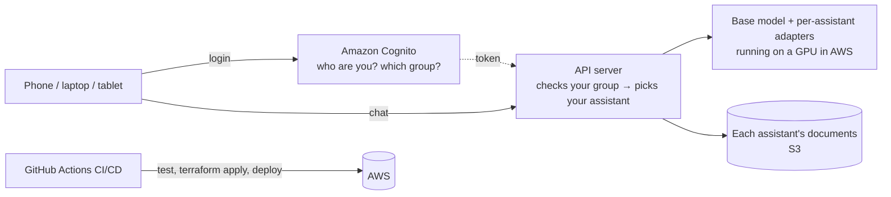

# Private AI Assistants

One open-source AI model, many personal assistants. Each assistant has its own personality, knowledge and training, and only the people allowed to use it can log in. It runs on AWS, is built with Terraform, deploys itself with GitHub Actions, and works from any device with a browser.

This repo is also a learning journal: I'm building it from zero and recording every step, mistake and fix in [LOG.md](LOG.md).

## How it fits together

## Progress

| Phase | What | Status |
|---|---|---|
| 0 | Accounts, tools, safety (billing alarm, MFA) | 🟡 nearly done (MFA + spend limit left) |
| 1 | Run the model on my own PC | 🟡 in progress |
| 2 | Tiny API with multiple assistants | ⬜ |
| 3 | Personalise: prompts → documents (RAG) → fine-tuning (LoRA) | ⬜ |
| 4 | Logins and per-person access (Cognito) | ⬜ |
| 5 | Infrastructure as code (Terraform) | ⬜ |
| 6 | Deploy to AWS | ⬜ |
| 7 | CI/CD (GitHub Actions) | ⬜ |
| 8 | Web app for every device | ⬜ |
| 9 | Monitoring, logs, cost control | ⬜ |

Full plan: [docs/ROADMAP.md](docs/ROADMAP.md) · Current step: [docs/phase-1-local-model.md](docs/phase-1-local-model.md) · Task board: [GitHub Project](https://github.com/users/subhan-sajid/projects/1) · Build log: [LOG.md](LOG.md)
